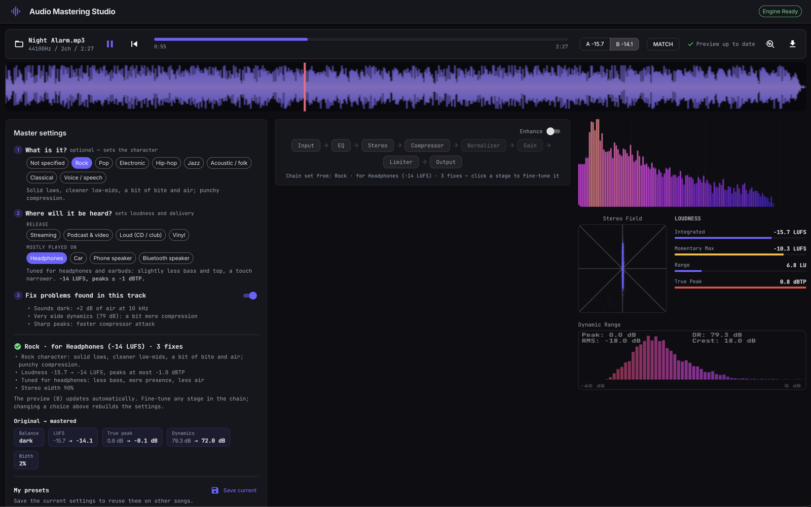
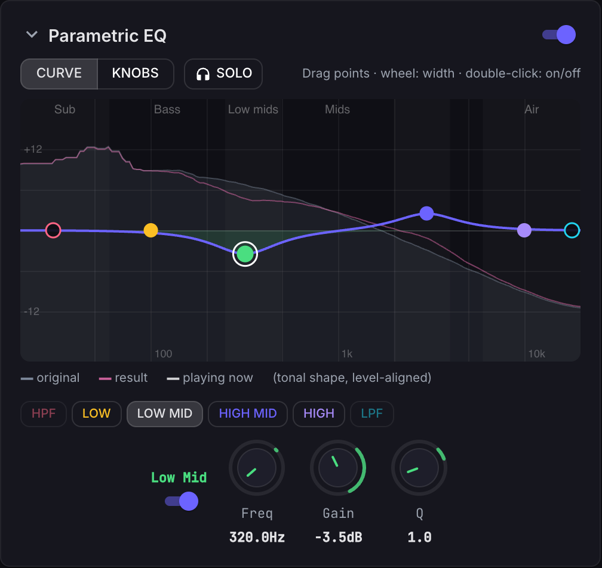
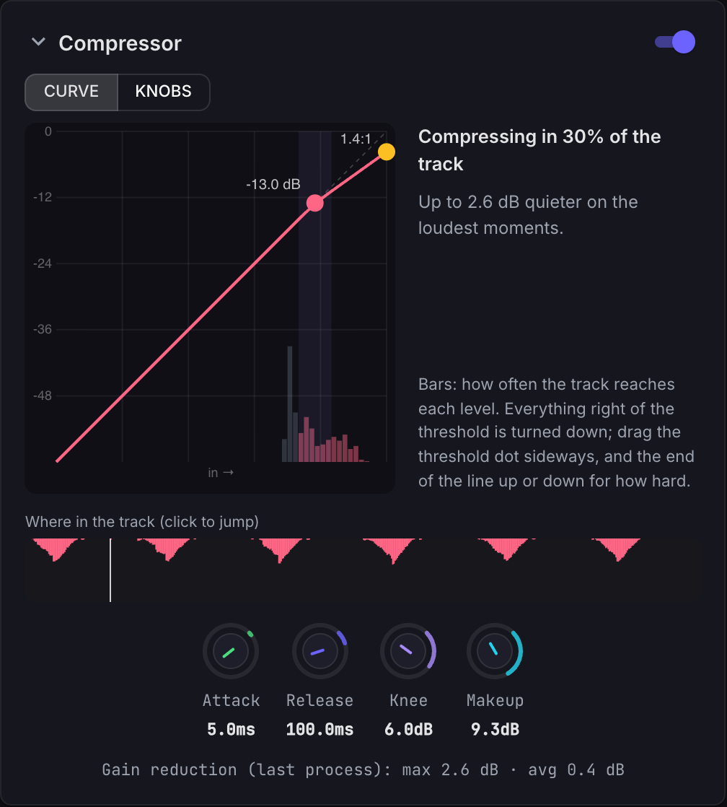
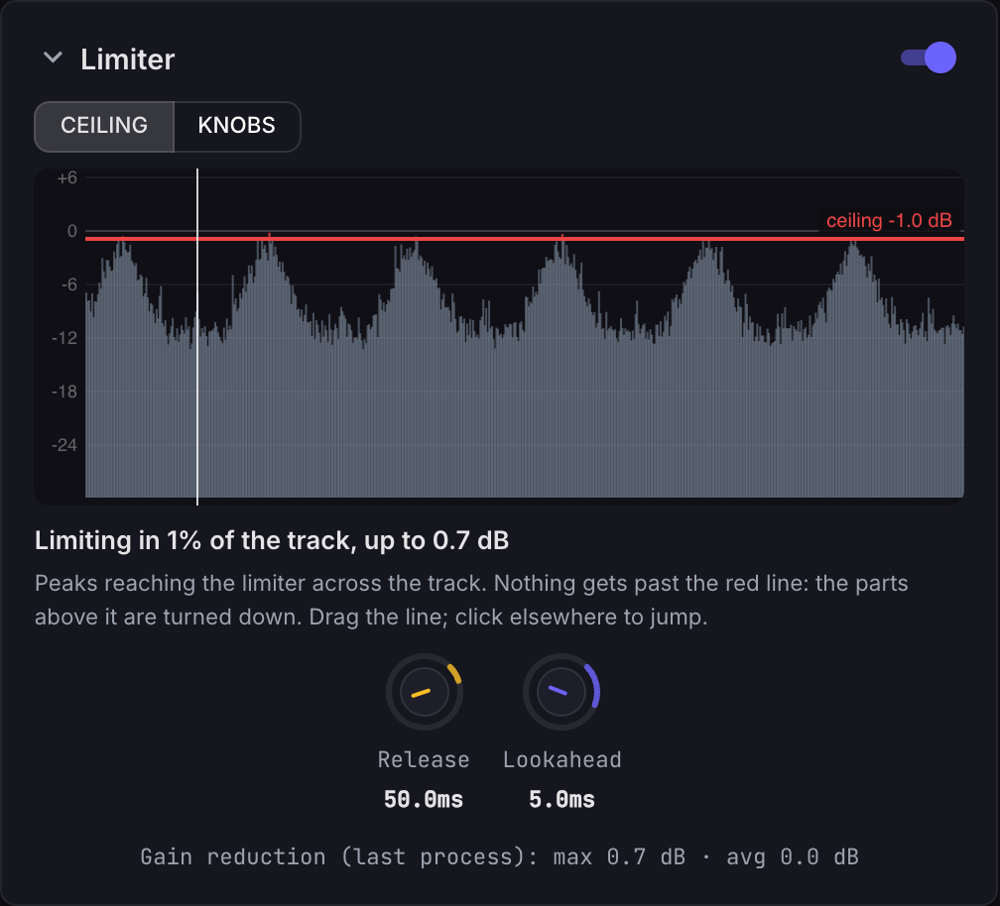
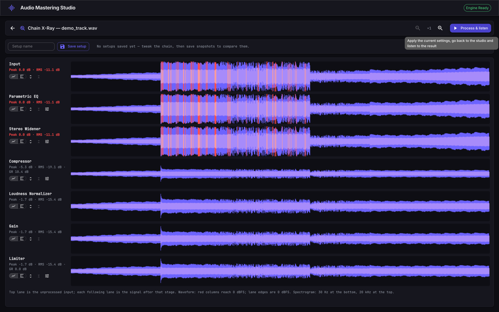
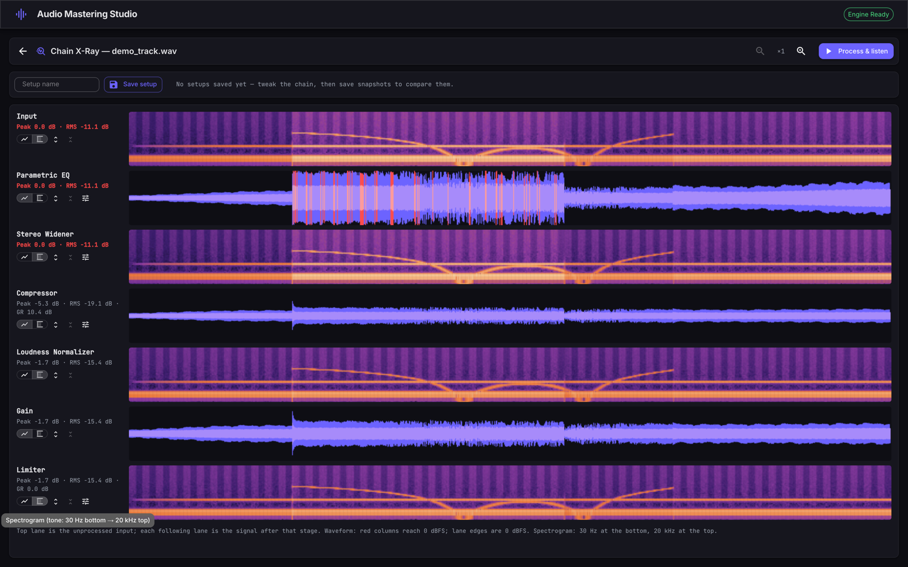

# Audio Mastering Studio

A professional audio mastering tool written in Go with a CLI and a React/WebAssembly web UI. Process audio through a configurable DSP chain (EQ, compression, limiting, stereo processing), analyze tracks, and master by saying what the music is and where it will be heard.



## Quick Start

```bash
# Build everything (CLI + WASM + Web UI)
./build.sh

# Master a file: what it is, where it will be heard
./bin/master process input.wav -o output.wav --style rock --for podcast

# See what mastering would do, and what it would fix
./bin/master analyze input.wav --style rock --for podcast

# List the styles and destinations
./bin/master options

# Launch the web UI
cd web && npx vite
```

## CLI Commands

| Command                                 | Description                                                  |
| ---------------------------------------- | ------------------------------------------------------------ |
| `master process <file> -o <out>`         | Master a single file                                          |
| `master analyze <file>`                  | Analyze audio and show what mastering would do and fix        |
| `master options`                         | List the styles (`--style`) and destinations (`--for`)        |
| `master batch <dir> -o <outdir>`         | Master every file in a directory independently                 |
| `master album <dir> -o <outdir>`         | Master a directory as one album: the album's style and destination for every track, each corrected for its own problems, loudness normalized by a single offset computed from the album's integrated loudness (preserves relative track levels) — use this instead of `batch` for related tracks |
| `master preset list\|search\|show`        | Your saved presets in `~/.audiomaster/presets`                 |

`process`, `analyze`, `batch` and `album` all choose their settings the same way, with the flags below.

### Settings flags

- `-o, --output` — Output file path (required)
- `--style` — What the material is, sets the character: `rock`, `pop`, `electronic`, `hiphop`, `jazz`, `acoustic`, `classical`, `voice`
- `--for` — Where it will be heard, sets loudness and delivery: `streaming` (−14 LUFS, default), `podcast` (−16), `loud` (−9), `vinyl`, `headphones`, `car`, `phone`, `bluetooth`
- `--no-fix` — Don't correct problems found by analysing the audio (too dark, squashed…)
- `-p, --preset` — Use a saved preset from `~/.audiomaster/presets` instead of `--style`/`--for`

The limiter ceiling is a true-peak ceiling: `--for streaming` delivers at most −1 dBTP, inter-sample peaks included.

### Process flags

- `-b, --bit-depth` — Output bit depth (16, 24, 32; default: same as input)
- `-r, --sample-rate` — Output sample rate in Hz (default: same as input)
- `--eq`, `--comp`, `--limit` — Toggle individual processors

## Web UI

The web interface runs the Go DSP engine via WebAssembly in a Web Worker (so processing never blocks the UI). Features:

- Start by saying what you're mastering: one track, or an album. With a single track, open the next song when you're done (your choices carry over), or grow it into an album
- Album mastering in three steps, the way albums are mastered: choose the release (destination and the album's usual style), get each track right (its own fixes, an optional different style, fine-tuning), then balance the album — levels in play order against the target with ± nudges, tracks whose tone stands out, reordering, and listening across each transition — before exporting a zip. One shared loudness offset keeps the intended level differences between tracks
- Chain X-Ray: a full-screen workbench showing the signal at every stage of the chain as waveform or spectrogram lanes, with in-place processor editing (changes ripple through downstream lanes) and instant visual A/B between saved setups
- Loudness-matched A/B (original vs processed, trimmed to equal LUFS) and per-run gain-reduction stats
- Every processor has two views: a picture you edit by dragging, and the classic knobs (see below)
- EQ and stereo width changes are heard instantly while playing; EQ band solo and a mono check let you hear what a change does
- Spectrum analyzer, waveform display, stereo field (Lissajous), LUFS meter
- Master settings in three questions — *What is it?* (style, optional), *Where will it be heard?* (destination), *Fix problems found?* — that combine (a rock song for a podcast keeps rock's tone at podcast loudness), with a plain-language list of what the settings do
- The preview updates by itself after every change, no Process step; fine-tune any stage in the chain, and save the result as your own preset

### Editing by ear: the visual views

Each processor panel opens on a visual view; **Knobs** is one click away for exact values. The browser remembers your choice per panel.

**EQ — Curve.** The EQ's real response, drawn over the track's spectrum (original, result, and what's playing right now), with the frequency zones labelled — Sub, Bass, Low mids, Mids, … Air — so "a bit less mud" has an obvious place to go.

- Drag a point: sideways for frequency, up or down for boost or cut. The mouse wheel makes a band wider or narrower, and double-click switches it on or off.
- **Hear it while you drag.** Press play on B and move a point: the change is heard immediately, not after the next render. The rendered preview catches up a moment later and takes over seamlessly.
- **Solo.** With Solo on, press and hold a point to hear only the range that band works on. You hear at once whether the 300 Hz you're about to cut really is the boxiness, and whether the boost really lands on the vocal.



**Compressor — Curve.** The in/out curve over a histogram of the track's levels. Drag the threshold dot sideways and the end of the line up or down for how hard. While you drag, the panel already tells you how much of the track gets compressed and by how much, and a strip shows where in the song it happens.



**Limiter — Ceiling.** The peaks reaching the limiter across the whole track, with the ceiling as a red line you drag. The parts above the line are what gets cut. A warning appears when the limiting gets heavy enough to sound squashed.



**Stereo — Stage.** The sound between two speakers; drag its edges from mono through as recorded to extra wide, and hear the change while playing. *Hold: mono check* plays the track in mono, the way a phone or a single speaker does, and a warning appears when a wide setting risks parts of the mix vanishing there.

**Bass and Treble Exciter — Harmonics.** The band the exciter feeds on and where its added overtones land, over the track's spectrum. Drag the dot sideways for where and up for how much.

Only the EQ and stereo width are heard instantly, because they can be applied on top of the playing preview exactly. The compressor, limiter and exciters respond to the signal over time, so their sound follows when the preview re-renders, about a second later. Their pictures and numbers still update instantly while you drag.

### Chain X-Ray

A full-screen workbench: the signal at every stage of the chain as stacked lanes, switchable between waveform (dynamics — red where a stage hits 0 dBFS) and spectrogram (tone — 30 Hz to 20 kHz). Edit a processor in place and the change ripples through every lane downstream, so you can watch, for instance, the compressor swallow the clipping the EQ stage still shows.



Save the current settings as a named setup, tweak further, save another — clicking between setup chips flips every lane to that setup's captured state instantly, no reprocessing, so differences are a blink comparison rather than a diff you have to decode.



## DSP Chain

The full chain used by the web UI and CLI (`engine.NewFullChain`) runs in this order — the limiter stays last so its ceiling holds on the actual output:

1. **Parametric EQ** — 6-band (HPF, low shelf, 2× peak, high shelf, LPF)
2. **Bass Exciter** — Harmonic exciter isolating lows, generating harmonics audible on speakers that can't reproduce true sub-bass (disabled by default)
3. **Stereo Widener** — Mid/side width control
4. **Compressor** — Soft-knee with attack/release envelope
5. **Treble Exciter** — Harmonic exciter isolating highs, restoring presence gain reduction tends to dull (disabled by default)
6. **Loudness Normalizer** — LUFS-based normalization (disabled by default; the web UI enables it, the CLI enables it when a preset configures it)
7. **Gain** — Unity by default; carries the shared album loudness offset in album mastering
8. **Limiter** — Lookahead brickwall limiter, zero added latency

Both exciters start disabled — they add harmonic content that isn't in the source (a creative choice, not a corrective one) — and are switched on by the target-device recommendations (phone, bluetooth, car) or explicitly via their `enabled` param.

`pkg/dsp` also implements a Multiband Compressor, a (separate, unused) Harmonic Exciter, and a De-Esser — functional and tested, but not yet wired into any chain or preset.

## Supported Formats

| Format | Read | Write                     |
| ------ | ---- | ------------------------- |
| WAV    | Yes  | Yes                       |
| FLAC   | Yes  | Yes (requires `flac` CLI) |
| MP3    | Yes  | —                         |
| OGG    | Yes  | —                         |
| AIFF   | Yes  | —                         |

## Project Structure

```
cmd/master/       CLI application (cobra)
cmd/wasm/         WebAssembly entry point (syscall/js)
pkg/dsp/          DSP processors (all implement Processor interface)
pkg/engine/       Mastering engine / pipeline orchestration
pkg/io/           Audio file readers and writers
pkg/analysis/     Spectrum, dynamics, stereo, loudness analysis
pkg/recipe/       Chain settings from style × destination × fixes
pkg/preset/       User presets (~/.audiomaster/presets/)
pkg/wasm/         JS↔Go bridge for WASM
web/              React + Vite + TypeScript + Material UI
```

## Building

Requires Go 1.21+ and Node.js 18+.

```bash
# Full build (tests + CLI + WASM + web)
./build.sh

# Tests only
go test ./pkg/... -v

# CLI only
go build -o bin/master ./cmd/master/

# WASM only
GOOS=js GOARCH=wasm go build -o web/public/engine.wasm ./cmd/wasm/
```