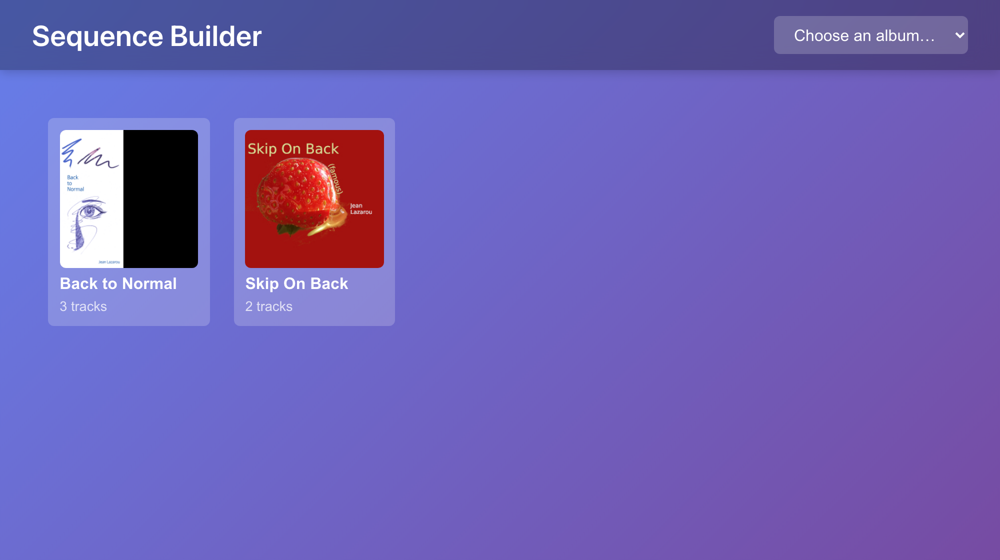

# Sequence Builder

A track transition tester for playlist curation. Test how tracks flow together by listening to endings and beginnings without loading entire files.


## Features

- 🎵 **Smart Loading**: Only keeps the first/last seconds of each track
- ⏱️ **Preview Length**: 5 to 15 seconds, set on a small timer dial
- 🎨 **Colorful Grid**: Visual, easy-to-navigate track display
- ▶️ **Transition Testing**: Click tracks to hear how they flow together
- 🔄 **Replay Mode**: Review your entire sequence with visual feedback
- 💾 **Export**: Save your curated sequence as a new playlist JSON

## Quick Start

```bash
pnpm install
pnpm start
# or
pnpm dev
```

Vite will automatically open [http://localhost:3000](http://localhost:3000) in your browser.

## Usage



1. **Choose an Album**: Pick one of the suite's albums (from `data/albums.json`) on the start screen, or switch with the selector in the header
2. **Set the preview length** (optional): Drag the dial's hand, scroll over it, or use the arrow keys — 5 to 15 s, 10 by default
3. **Build a Sequence**: Click tiles to add tracks to your sequence
   - First click: Plays the track's ending
   - Subsequent clicks: Plays transition (previous ending → new beginning)
4. **Review**: Click "Replay" to hear the full sequence with visual highlighting
5. **Save**: Export your sequence as a new playlist JSON file

## Albums

Like the other suite apps, Sequence Builder reads the suite's albums: `data/albums.json`
and one `<name>.json` per album, audio under `music/files/`. Link them into `public/` with

```bash
../scripts/link_data.sh demo sequence-builder      # the demo albums in examples/
../scripts/link_data.sh library sequence-builder   # your own collection
```

On the suite's demo site the app finds the shared `../data` and `../music` instead.

Saved sequences use the same format as an album file, so the Player can open them:

```json
{
  "title": "My Album - Sequenced",
  "playlist": [
    {
      "url": "/music/files/My Album/track.mp3",
      "title": "Track Title",
      "authors": ["Artist Name"],
      "rating": 5,
      "enabled": true
    }
  ]
}
```

## Memory Optimization

Traditional players load entire audio files (50 tracks × 7MB ≈ 350MB). Sequence Builder keeps only the first and last 15 seconds of each track (50 tracks ≈ 36MB), enabling fast, smooth transitions without memory issues.

## Browser Requirements

- Modern browser with Web Audio API support
- Server must support HTTP Range requests (for future optimization)

## Part of Mazy Suite

- **Player**: Full-featured music player with lyrics, waveforms, playlists
- **Sequence Builder**: This app - transition testing and curation tool

---

Built with Vite + React 18 + TypeScript
